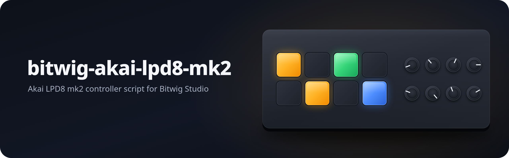

<p align="center">
  
</p>

<p align="center">
  
  
</p>

A Bitwig Studio controller script for the **Akai LPD8 mk2**. Plug it in and it just works:

- **The 8 knobs control whatever device you've selected**, so you don't have to map anything. Click a synth and the knobs move its parameters. Click an effect and they move the effect's.
- **The pads play your instruments and drums.**
- **Hit CC and the pads launch the selected track's clips**, lit in each clip's colour.
- **Hit Prog Chng and the pads move between tracks, devices and parameter pages** without touching the mouse.

It needs no setup on the controller itself.

> **Only for the LPD8 mk2.** The first-generation LPD8 (no coloured pads) is not supported.

- [Install](#install) ([Linux](#linux), [Windows](#windows), [macOS](#macos))
- [Turn it on in Bitwig](#turn-it-on-in-bitwig)
- [How to use it](#how-to-use-it)
- [Troubleshooting](#troubleshooting)

---

## Install

The whole script is **one file**: `AkaiLPD8mk2.control.js`. Installing means putting that file into Bitwig's *Controller Scripts* folder. Pick your system below.

> **Updating?** Do exactly the same thing: the new file replaces the old one. Then quit Bitwig completely and start it again.

### Linux

**Option A: copy & paste one command**

Open a terminal, paste this, and press Enter:

```sh
mkdir -p ~/"Bitwig Studio/Controller Scripts" && curl -fL -o ~/"Bitwig Studio/Controller Scripts/AkaiLPD8mk2.control.js" https://github.com/relatively-okay/bitwig-akai-lpd8-mk2/releases/latest/download/AkaiLPD8mk2.control.js
```

**Option B: by hand**

1. Download the script: **[AkaiLPD8mk2.control.js](https://github.com/relatively-okay/bitwig-akai-lpd8-mk2/releases/latest/download/AkaiLPD8mk2.control.js)**
2. Open your home folder and go into **`Bitwig Studio`**, then **`Controller Scripts`**.
   If there is no `Controller Scripts` folder, create it (spelled exactly like that, with the space).
3. Move the downloaded `AkaiLPD8mk2.control.js` into `Controller Scripts`.

Now go to [Turn it on in Bitwig](#turn-it-on-in-bitwig).

### Windows

**Option A: copy & paste one command**

Press the **Windows key**, type **PowerShell**, open it, paste this, and press Enter:

```powershell
$d = Join-Path ([Environment]::GetFolderPath('MyDocuments')) 'Bitwig Studio\Controller Scripts'; New-Item -ItemType Directory -Force -Path $d | Out-Null; Invoke-WebRequest -Uri 'https://github.com/relatively-okay/bitwig-akai-lpd8-mk2/releases/latest/download/AkaiLPD8mk2.control.js' -OutFile (Join-Path $d 'AkaiLPD8mk2.control.js')
```

**Option B: by hand**

1. Download the script: **[AkaiLPD8mk2.control.js](https://github.com/relatively-okay/bitwig-akai-lpd8-mk2/releases/latest/download/AkaiLPD8mk2.control.js)**
2. Open **File Explorer**, click **Documents**, then open **`Bitwig Studio`**, then **`Controller Scripts`**.
   If there is no `Controller Scripts` folder, create it (spelled exactly like that, with the space).
3. Move the downloaded `AkaiLPD8mk2.control.js` (it's in your **Downloads** folder) into `Controller Scripts`.

> Windows sometimes hides file extensions, so the file may show up as just `AkaiLPD8mk2.control`. That's fine. Don't rename it, and make sure it did **not** turn into `….js.txt`.

Now go to [Turn it on in Bitwig](#turn-it-on-in-bitwig).

### macOS

**Option A: copy & paste one command**

Open **Terminal** (press **Cmd + Space**, type *Terminal*, press Enter), paste this, and press Enter:

```sh
mkdir -p ~/Documents/"Bitwig Studio/Controller Scripts" && curl -fL -o ~/Documents/"Bitwig Studio/Controller Scripts/AkaiLPD8mk2.control.js" https://github.com/relatively-okay/bitwig-akai-lpd8-mk2/releases/latest/download/AkaiLPD8mk2.control.js
```

**Option B: by hand**

1. Download the script: **[AkaiLPD8mk2.control.js](https://github.com/relatively-okay/bitwig-akai-lpd8-mk2/releases/latest/download/AkaiLPD8mk2.control.js)**
2. Open **Finder**, click **Documents**, then open **`Bitwig Studio`**, then **`Controller Scripts`**.
   If there is no `Controller Scripts` folder, create it (spelled exactly like that, with the space).
3. Move the downloaded `AkaiLPD8mk2.control.js` (it's in your **Downloads** folder) into `Controller Scripts`.

Now go to [Turn it on in Bitwig](#turn-it-on-in-bitwig).

> **Can't find the `Bitwig Studio` folder?** It's the folder where Bitwig keeps your *Projects* and *Library*. `Controller Scripts` goes right next to those.

---

## Turn it on in Bitwig

1. Plug in the LPD8 mk2.
2. **Restart Bitwig Studio** (quit it completely and open it again).
3. Bitwig usually finds the controller by itself and shows **"LPD8 mk2 ready"**. Done!

If that popup doesn't appear, add the controller by hand:

1. Open Bitwig's **Settings** and go to **Controllers**.
2. Click **Add Controller**.
3. Choose **Akai** as the vendor and **LPD8 mk2** as the model, then click **Add**.
4. Set **both** dropdowns, the MIDI input *and* the MIDI output, to **LPD8 mk2**.
   The script needs the output too, so it can read the controller's settings and light up the pads.

You should now see **"LPD8 mk2 ready"**, and the pads light up.

---

## How to use it

### Knobs: they follow the selected device

Click any device in Bitwig: an instrument, an effect or a plugin. The 8 knobs now control that device's **Remote Controls**, the 8 parameters Bitwig shows in the device's *Remote Controls* panel. Bitwig highlights the parameters the knobs are on. Select another device and the knobs follow.

**Pickup:** after you switch device, page or bank, a knob doesn't do anything until you turn it past the parameter's current value. Then it grabs the parameter and follows smoothly. This stops sounds from jumping when the knob and the parameter don't match. If you'd rather the value jumps straight to the knob, set **Knob takeover** to **Jump** in *Settings → Controllers*, under the LPD8 mk2.

### The pad modes

The **Note**, **CC** and **Prog Chng** buttons on the LPD8 mk2 choose what the pads do. The pad lights switch to that mode's layout as soon as you hit a pad. Pads 1–4 are the bottom row, and pads 5–8 the top row.

#### Note mode: play instruments

The pads play notes on the selected track, with pressure, and light up while you hold them. On a Drum Machine, pads 1–8 play its first 8 pads.

#### CC mode: clips of the selected track

```
  ┌──────────────┬──────────────┬──────────────┬──────────────┐
  │  5           │  6           │  7           │  8           │
  │  clip 1      │  clip 2      │  clip 3      │  clip 4      │
  ├──────────────┼──────────────┼──────────────┼──────────────┤
  │  1           │  2           │  3           │  4           │
  │  stop track  │  stop all    │  previous    │  next        │
  │              │  clips       │  4 clips     │  4 clips     │
  └──────────────┴──────────────┴──────────────┴──────────────┘
```

The top row is the first 4 clip slots of the track you've selected. Select a track with the mouse, or with Prog Chng mode, and the top row follows. Bitwig draws a frame around the 4 slots the pads are on. Pads 3 and 4 move that frame to the previous or next 4 slots.

Each clip pad lights up in **the clip's own colour**:

| Clip pad          | Meaning                                         |
|-------------------|-------------------------------------------------|
| off               | empty slot                                      |
| dim               | there's a clip, not playing                     |
| bright            | playing                                         |
| blinking          | starts on the next beat                         |
| red               | recording                                       |
| blinking red      | about to stop, or about to start recording      |

Hit a clip pad to launch the clip. On a track that's armed for recording, hitting an empty pad records a new clip there.

#### Prog Chng mode: get around without the mouse

```
  ┌──────────────┬──────────────┬──────────────┬──────────────┐
  │  5           │  6           │  7           │  8           │
  │  previous    │  next        │  previous    │  next        │
  │  page        │  page        │  device      │  device      │
  ├──────────────┼──────────────┼──────────────┼──────────────┤
  │  1           │  2           │  3           │  4           │
  │  previous    │  next        │  knobs:      │  next user   │
  │  track       │  track       │  device/user │  bank        │
  └──────────────┴──────────────┴──────────────┴──────────────┘
```

A popup tells you where you landed, for example *"Polysynth - Filter"*. A pad goes dark when there's nowhere further to go in that direction.

**User banks** let you map the knobs yourself instead: 8 banks of 8 knobs, so 64 mappings in total. Hit pad 3 (**knobs: device/user**) to switch the knobs to them, and pad 4 (**next user bank**) to step through the banks. To map one, right-click a parameter in Bitwig, choose **Map to Controller or Key**, and turn the knob. Hit pad 3 again to go back to device control.

### Your own LPD8 mk2 programs work too

The script doesn't assume the factory settings. Every time it starts, it reads the four programs from the controller and uses whatever knob and pad numbers you've set up, on any MIDI channel. It **never writes** anything to the controller.

If you change the programs with Akai's editor while Bitwig is running, switch the controller off and on in *Settings → Controllers* to make the script read them again.

---

## Troubleshooting

| Problem | Fix |
|---|---|
| **LPD8 mk2** isn't in the *Add Controller* list | The file isn't in the right place, or it isn't named right. It must be in `Bitwig Studio/Controller Scripts/` and end in **`.control.js`**. Then restart Bitwig. |
| Popup: *"no reply - check the controller's MIDI output port"* | In *Settings → Controllers*, set the controller's **output** to LPD8 mk2. |
| Popup: *"This is an original LPD8"* | This script only works with the LPD8 **mk2**. |
| A knob does nothing | That's pickup: turn it past the parameter's current value. Also check that a device is selected, or set **Knob takeover** to **Jump**. |
| Pads play notes but don't launch clips | Press the **CC** button on the LPD8 mk2. |
| Pad lights show the wrong layout | Hit any pad once. The controller doesn't report mode changes, so the lights switch on the first pad hit. |
| Every second pad press is ignored | That pad is set to *toggle* in your program. Set it to *momentary*. |
| Error after updating: *"This cannot be called when specifying required API version 1"* | Quit Bitwig completely and start it again. Bitwig only re-reads controller scripts on startup. |
| Something else | Open Bitwig's **Controller Script Console**. The script writes what it found and anything it ignored there, starting with `LPD8 mk2:`. |

---

## Compatibility

Developed and tested on Bitwig Studio 4.4 with a real LPD8 mk2. The script uses version 10 of Bitwig's controller API. Everything it uses is still in Bitwig Studio 6.1 unchanged, so newer versions should work as well.

## Development

The script runs against a mock Bitwig host and a fake LPD8 mk2, using program dumps read from real hardware:

```sh
node test/run.js
```

This started as a fork of [stylemistake/bitwig-lpd8](https://github.com/stylemistake/bitwig-lpd8) (for the first-generation LPD8) and keeps its clip-launcher pad layout, but the code has since been rewritten for the mk2.

## License

[MIT](LICENSE)
